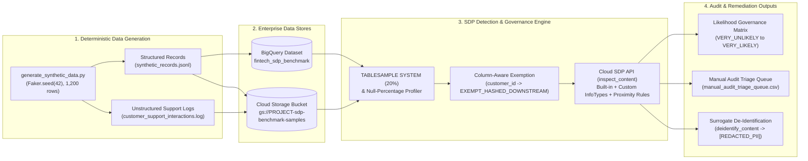

# GCP Sensitive Data Protection (SDP) Governance & Precision Benchmark

[](https://colab.research.google.com/github/BrianReevz/gcp-sdp-governance-benchmark/blob/main/notebooks/sdp_detection_and_governance_benchmark.ipynb)
[](https://www.python.org/)
[](https://cloud.google.com/sensitive-data-protection)
[](https://cloud.google.com/bigquery)
[](https://opensource.org/licenses/Apache-2.0)

An enterprise-grade, vendor-neutral reference architecture and interactive benchmark suite for evaluating **Google Cloud Sensitive Data Protection (SDP / Cloud DLP)** detection taxonomy, contextual proximity rules, column-aware exemptions, and likelihood thresholds across structured **BigQuery** tables and unstructured **Cloud Storage (GCS)** logs.

---

## 1. Architecture Overview

The following architecture illustrates the end-to-end data generation, sampling, contextual inspection, governance matrix aggregation, and de-identification workflow implemented in this repository.



---

## 2. The Enterprise Challenge: Balancing Zero-Risk Tolerance with False-Positive Fatigue

Financial services and digital payment ecosystems process billions of heterogeneous payloads daily—spanning structured relational tables, semi-structured JSON events, and free-text customer support transcripts. Security and privacy engineering teams face a fundamental tension:

1. **Zero-Risk Compliance Mandate:** Regulatory frameworks require exhaustive discovery of Payment Card Industry (PCI) Primary Account Numbers (PANs), Social Security Numbers (SSNs), full residential street addresses, and live API credentials (`tok_synth_...`). Missing a single true positive introduces material compliance exposure.
2. **False-Positive Fatigue:** Naive regular expressions or overly broad detectors trigger thousands of false alarms on benign operational data:
   * **Standalone Geography:** `City`, `State`, and `ZIP` columns flagged as full residential PII without a contiguous `Street Address Line 1`.
   * **Numeric Disambiguation:** 16-digit unformatted ledger currency amounts (e.g., `1000000000250000` representing `$10,000,000.00250000`) misclassified as credit card numbers when Luhn validation and contextual hotwords are absent.
   * **Cryptographic & System Identifiers:** Deterministic Git commit SHAs, UUIDv4 transaction correlation IDs, and downstream SHA-256 hashed customer keys mistaken for high-entropy secrets.
   * **Sparse Column Overhead:** Scanning 95%-null free-text columns across petabyte-scale tables without pre-profiling null density wastes inspection quota and inflates latency.

This benchmark demonstrates how **Google Cloud Sensitive Data Protection (SDP)** resolves this dilemma using **Hotword Proximity Rules**, **Exclusion Rules**, **Column-Aware Downstream Exemptions**, **BigQuery System Table Sampling**, and **Empirical Likelihood Thresholding**.

---

## 3. Detection Taxonomy & Proximity Rules

The benchmark evaluates a hybrid taxonomy combining Google-managed **Built-in InfoTypes** with domain-specific **Custom InfoTypes** and **Contextual Inspection Rule Sets**:

| InfoType Name | Category | Detector Type | Pattern / Logic | Contextual Proximity / Governance Rule | Target Disposition |
| :--- | :--- | :--- | :--- | :--- | :--- |
| `CREDIT_CARD_NUMBER` | PCI-DSS | Built-in | 13–19 digit PAN + Luhn check | Downgrade to `VERY_UNLIKELY` if within 35 chars of currency/ledger hotwords (`usd_ledger_raw`, `minor_units`, `FX_RATE`) | **Inspect & Mask** |
| `US_SOCIAL_SECURITY_NUMBER` | Government PII | Built-in | 9-digit US SSN format | Boost to `VERY_LIKELY` when near `ssn`, `tax_id`, `social_security` | **Inspect & Mask** |
| `STREET_ADDRESS` | Residential PII | Built-in | NLP + structural location parser | **Proximity Rule:** Requires street number/suffix (`St`, `Ave`, `Blvd`, `Apt`) within 30 chars; standalone `City/State/ZIP` excluded | **Contextual Filter** |
| `EMAIL_ADDRESS` | Contact PII | Built-in | RFC 5322 email syntax | Exempt RFC 2606 synthetic system accounts (`*@system.internal.test`) | **Inspect & Mask** |
| `PHONE_NUMBER` | Contact PII | Built-in | E.164 / NANP phone patterns | Boost likelihood in sparse `support_notes` columns | **Inspect & Mask** |
| `CUSTOM_MERCHANT_ACCOUNT_ID` | Platform ID | Custom Regex | `ACCT-[0-9A-Z]{10}` | Boost to `VERY_LIKELY` near `account`, `merchant`, `payer_id` | **Inspect & Triage** |
| `CUSTOM_P2P_WALLET_HANDLE` | Platform ID | Custom Regex | `@[A-Za-z0-9_-]{3,30}` | Exclude common email domain suffixes (`@example.com`, `@internal.test`) | **Inspect & Triage** |
| `CUSTOM_HIGH_ENTROPY_CREDENTIAL` | Secret / Auth | Custom Regex | `tok_synth_[a-f0-9]{16,64}` | Boost to `VERY_LIKELY` within 40 chars of `Authorization`, `Bearer`, `api_key`; exclude `git_sha` / `uuid` | **Immediate Remediation** |
| `customer_id` (Column 1) | Internal Key | Column Metadata | `CUST-[0-9]{8}` | Tagged `EXEMPT_HASHED_DOWNSTREAM` via column-level governance policy | **Exempt (Skip API)** |

---

## 4. Repository Structure & Quickstart Guide

### Repository Structure

```text
gcp-sdp-governance-benchmark/
├── README.md                                              # Architecture & governance documentation
├── requirements.txt                                       # Pinned Python dependencies
├── LICENSE                                                # Apache 2.0 License
├── CONTRIBUTING.md                                        # Security sanitization & contribution guidelines
├── scripts/
│   ├── generate_synthetic_data.py                         # Deterministic (Faker.seed(42)) dataset & log generator
│   ├── deploy_test_stores.sh                              # Idempotent BigQuery & GCS provisioning script
│   └── sanitize_notebook_outputs.py                       # Output sanitizer for public GitHub commits
├── data/
│   └── samples/                                           # Generated JSONL, CSV, and unstructured support logs
└── notebooks/
    └── sdp_detection_and_governance_benchmark.ipynb       # Colab-compatible benchmark & governance notebook
```

### Prerequisites

* **Python:** `3.10+`
* **Google Cloud SDK:** `gcloud` and `bq` CLI tools installed and authenticated.
* **GCP Project:** Active project with the following APIs enabled:
  * Sensitive Data Protection (`dlp.googleapis.com`)
  * BigQuery (`bigquery.googleapis.com`)
  * Cloud Storage (`storage.googleapis.com`)
* **IAM Roles:**
  * `roles/dlp.user` (DLP User)
  * `roles/bigquery.dataEditor` & `roles/bigquery.jobUser`
  * `roles/storage.admin` (or `roles/storage.objectAdmin` on the target bucket)

### Environment Setup & Execution

#### Option A: Run in Hosted Google Colab (Zero Local Setup)
1. Click **[Open in Colab](https://colab.research.google.com/github/BrianReevz/gcp-sdp-governance-benchmark/blob/main/notebooks/sdp_detection_and_governance_benchmark.ipynb)**.
2. In **Step 1**, the notebook automatically clones the repository (`data/samples/` and `scripts/`) into the ephemeral Colab VM (`/content`) and authenticates via `google.colab.auth.authenticate_user()`.
3. In **Step 2**, enter your `PROJECT_ID` in the Colab form field and keep `PROVISION_CLOUD_STORES_IF_MISSING = True` checked—the notebook will automatically provision the BigQuery dataset (`fintech_sdp_benchmark`), load the 1,200 synthetic rows, create/upload the GCS support logs bucket, and attach `quota_project_id=PROJECT_ID` to all Cloud SDP API requests.

#### Option B: Run Locally or in Vertex AI Workbench

```bash
# 1. Create and activate an isolated Python virtual environment
python3 -m venv .venv
source .venv/bin/activate

# 2. Install pinned dependencies
.venv/bin/pip install -r requirements.txt

# 3. Generate deterministic synthetic test data locally (1,200 rows & unstructured logs)
.venv/bin/python scripts/generate_synthetic_data.py

# 4. (Optional) Provision BigQuery dataset and GCS bucket with test data
chmod +x scripts/deploy_test_stores.sh
./scripts/deploy_test_stores.sh

# 5. Launch Jupyter or open notebooks/sdp_detection_and_governance_benchmark.ipynb
```

---

## 5. Empirical Likelihood Tuning: Precision vs. Recall Governance Trade-offs

Cloud SDP assigns every finding a discrete likelihood rating ranging from `VERY_UNLIKELY` (1) to `VERY_LIKELY` (5). Selecting the minimum threshold (`min_likelihood`) governs the operational trade-off between **Recall** (catching all sensitive leaks) and **Precision** (minimizing false-positive engineering triage):

| Minimum Likelihood Tier | Recall Profile | Precision Profile | Recommended Governance Use Case |
| :--- | :--- | :--- | :--- |
| **`VERY_UNLIKELY` / `UNLIKELY`** | Maximum (~99.9%) | Low (High noise from 16-digit numbers, partial strings) | Exploratory discovery on new external acquisitions; never use for automated blocking. |
| **`POSSIBLE`** | High (~98.5%) | Moderate | **Baseline Audit Queue:** Suitable for asynchronous human-in-the-loop review (`manual_audit_triage_queue.csv`) when paired with proximity exclusion rules. |
| **`LIKELY`** | Balanced (~96.0%) | High (~94%+) | **Production Default:** Recommended threshold for automated BigQuery column tagging, Data Catalog policy tags, and CI/CD pipeline gates. |
| **`VERY_LIKELY`** | Conservative | Very High (>99%) | **Automated Redaction / Pager Alerts:** Ideal for real-time `[REDACTED_PII]` surrogate masking in customer support logs and live secret revocation. |

---

## 6. Compliance & Audits

This benchmark aligns technical controls with enterprise regulatory requirements:

* **PCI-DSS v4.0 (Level 1):**
  * **Requirement 3.3 / 3.4:** Ensures Primary Account Numbers (PANs) are discovered across structured tables and unstructured support logs and rendered unreadable via deterministic surrogate masking (`[REDACTED_PII]`).
  * Reduces audit scope by proving that 16-digit ledger micro-currency fields do not contain valid cardholder data.
* **FedRAMP High (NIST SP 800-53 Rev. 5):**
  * **SI-4 (System Monitoring) & RA-5 (Vulnerability Monitoring):** Automates continuous discovery of unauthorized credentials (`tok_synth_*`) and SSNs across cloud storage boundaries.
  * **SC-28 (Protection of Information at Rest):** Validates downstream cryptographic hashing exemptions (`EXEMPT_HASHED_DOWNSTREAM`).
* **SOC 2 Type II (Trust Services Criteria - Confidentiality & Privacy):**
  * **CC6.1 / P4.2:** Provides reproducible, timestamped governance matrices and CSV triage queues demonstrating that data classification policies are enforced, measured, and audited.

---

## 7. Open Source Sanitization & Disclaimers

> **IMPORTANT DISCLAIMER:**
> * **100% Synthetic Data:** All names, street addresses, credit card numbers, Social Security Numbers, Merchant Account IDs (`ACCT-*`), P2P Wallet handles (`@*`), and API keys (`tok_synth_*`) in this repository are **synthetically generated** using `Faker.seed(42)` and deterministic test generators.
> * **RFC 2606 Reserved Domains:** All email addresses, webhook endpoints, and corporate domains strictly use IETF RFC 2606 reserved testing domains (`example.com`, `example.org`, `internal.test`).
> * **Vendor-Neutral Reference Architecture:** Dataset names (such as `fintech_sdp_benchmark`) and custom InfoType patterns are vendor-neutral architectural examples for benchmarking financial data governance and do not represent any specific institution's proprietary configurations.
